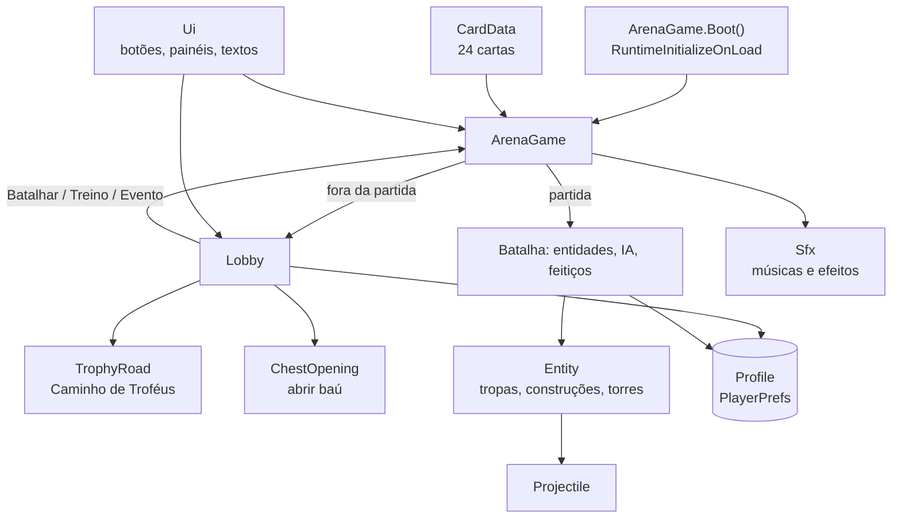
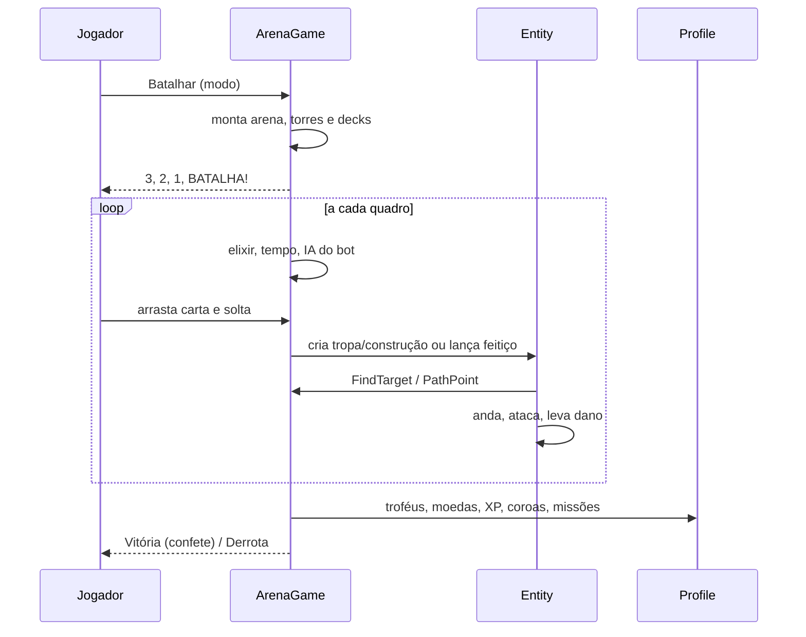
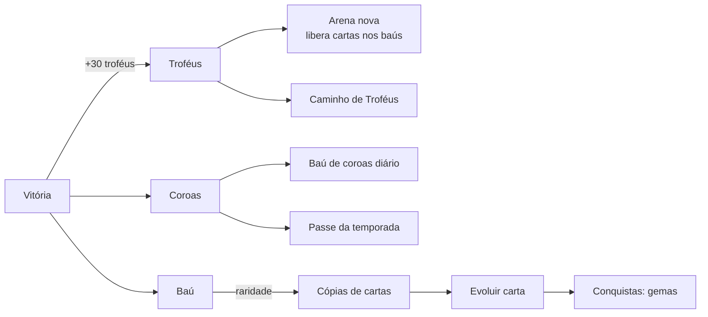

# Arquitetura do Arena de Cartas

Tudo é montado por código: ao apertar **Play**, `ArenaGame.Boot()` cria o objeto do jogo, e a interface é desenhada com IMGUI (`OnGUI`) dentro de uma "coluna de celular" 9:16.

## Visão geral

## Arquivos

O jogo usa **classes parciais** (`partial class`): cada classe grande é dividida em arquivos por assunto, para ficar fácil de ler e manter.

| Arquivo | O que faz |
|---|---|
| `ArenaGame.cs` | Núcleo: campos, inicialização, arte, câmera, laço principal (`Update`) e HUD da batalha |
| `ArenaGame.Partida.cs` | Montar a partida, torres, tropas, feitiços, EVO, Curandeira e Ladrão |
| `ArenaGame.Regras.cs` | Alvos, caminho pelas pontes, morte de unidades e recompensas do fim |
| `ArenaGame.IA.cs` | IA do bot (defesa, feitiços, ataque pela pista mais fraca) |
| `ArenaGame.Campeoes.cs` | Habilidades dos Campeões (Investida, Escudo de Vento) |
| `ArenaGame.Campanha.cs` | Chefes da campanha, clima, final em câmera lenta e regras das arenas |
| `ArenaGame.Efeitos.cs` | Partículas: poeira, marcas no chão, pedrinhas e faíscas |
| `ArenaGame.Tutorial.cs` | Tutorial com o Capitão Tomás |
| `ArenaGame.Resultado.cs` | Tela de fim de partida e toque/arrasto das cartas |
| `ArenaGame.Busca.cs` | Telas "Buscando adversário" e VS |
| `Lobby.cs` | Núcleo do lobby: barra de cima, navegação e janelas |
| `Lobby.Abas.cs` | Abas Batalha, Loja, Missões e Eventos (campanha, desafio, treino, passe) |
| `Lobby.Cartas.cs` | Deck, evolução, Despertar EVO e Livro de cartas |
| `Lobby.Janelas.cs` | Ajustes (com acessibilidade), perfil, visual das torres, tutorial, prêmio diário, mapa da campanha |
| `Lobby.Vivo.cs` | Avisos que deslizam e lobby animado |
| `Entity.cs` | Tudo que tem vida na arena: anda, mira, ataca, anima; voadoras, construções, escudo |
| `Projectile.cs` | Flechas, bombas, balas e magias em voo |
| `CardData.cs` | Definição das cartas: custo, vida, dano, raridade, habilidades |
| `Profile.cs` | Progresso salvo: troféus, coleção, decks, baús, missões, passe, conquistas, campanha, desafio |
| `TrophyRoad.cs` | Caminho de Troféus |
| `ChestOpening.cs` | Animação de abrir baú |
| `Sfx.cs` / `Ui.cs` | Som e componentes de interface (com escala de texto) |

## Uma partida

## Regras de alvo

- **Voadoras** (`flying`) passam por cima do rio e só são atingidas por quem tem `hitsAir` (quem atira, torres e feitiços).
- **Construções** (`CardKind.Building`) não andam, perdem vida com o tempo (`lifetime`) e atraem tropas que só atacam construções e torres (Gigante, Golem).
- **Corpo a corpo** não acerta voadores; isso é ajustado automaticamente em `CardData.All()`.

## Progressão

Raridades: Comum (60%), Rara (25%), Épica (12%), Lendária (3%). Quanto mais rara, menos cópias caem e menos cópias são pedidas para evoluir.

## Testes

`Assets/Tests` contém testes EditMode (Window > General > Test Runner). Eles verificam as cartas (chaves únicas, 8 iniciais, valores válidos, arte presente), as regras de voadoras, os multiplicadores de nível e o sorteio por raridade.

## Arte

Os personagens são modelos 3D feitos de formas simples e renderizados em Python (`Ferramentas/`). Cada personagem vira uma folha com 7 quadros (parado, andar x4, ataque x2) × 4 linhas (azul/vermelho, de frente/de costas).
