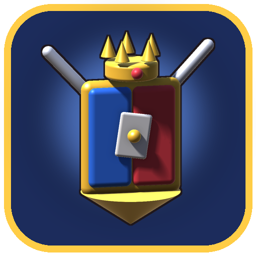
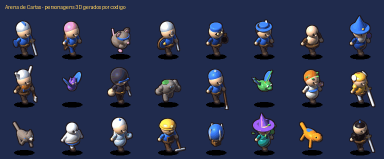
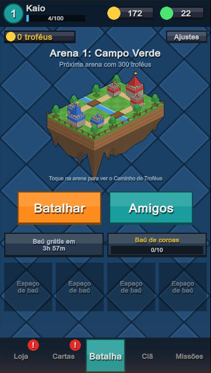
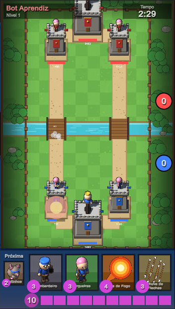

# ⚔️ ArenaDeCartas

Jogo de **batalha de cartas em tempo real** feito em **Unity 6.3 LTS (C#)**, inspirado no gênero dos jogos de arena para celular,
com **arte, personagens, sons e músicas 100% originais gerados por código**.

> Projeto pessoal de **Kaio Kelven** — estudante de Engenharia de Software (Anhanguera).

  

  
  &nbsp;&nbsp;
  

## 🎮 O jogo

Dois jogadores, três torres de cada lado, uma arena com duas pistas e um rio.
Você gasta **elixir** para soltar **cartas** (tropas e feitiços); quem derrubar a **torre do rei** vence.

### Funcionalidades

**Batalha**
- 36 cartas: tropas e construções com animação 3D (andar, atacar, de frente e de costas) e 7 feitiços
- Construções especiais: **Muralha** (segura os inimigos), **Torre de Gelo** (deixa o alvo lento) e **Fornalha** (solta Brasinhas)
- **Campeões** com habilidade ativa (Cavaleira Aurora e Bruxa Ventania) e **Despertar EVO** de cartas
- Tropas especiais: **Curandeira** (cura), **Escavador** (surge em qualquer lugar), **Ladrão** (rouba elixir) e **Balão de Bombas**
- **Tropas voadoras** (só quem atira acerta) e **construções** que atraem o Gigante e perdem vida com o tempo
- Raridades (Comum, Rara, Épica, Lendária) com moldura própria
- Feitiços de dano, **Gelo** (congela), **Cura** e **Tornado** (puxa as tropas)
- Fluxo completo: **Buscando adversário → tela de VS animada → partida → tela de fim com coroas e recompensas**
- Segurar e arrastar a carta até a arena, prévia da tropa e área proibida em vermelho
- Selo de nível em torres e tropas, relógio de preparo, números de dano e cura
- Elixir que recarrega (x2 no último minuto, x3 na prorrogação) e prorrogação com morte súbita
- Emotes com resposta do bot, confete na vitória e vibração no celular
- Dano em área, projéteis, bola de fogo, chuva de flechas, raio e meteoro
- **IA** que defende com a carta certa, usa feitiços em grupos e ataca pela pista mais fraca —
  e fica mais esperta conforme seus troféus sobem
- **8 adversários com personalidade** (Equilibrado, Agressivo, Defensivo e Feiticeiro), cada um com nome e frase
- **Replay** da partida na tela de fim, com velocidade x1, x2 e x4

**Progressão**
- 4 arenas com **Caminho de Troféus** (recompensas a cada 50 troféus)
- Piso de troféus por arena e **temporadas**
- Coleção de cartas: a arena **desbloqueia**, os **baús** entregam
- **Evolução das cartas** com cópias + moedas e **nível de rei** que fortalece as torres
- Baús com tempo de abertura, **baú grátis** a cada 4h e **baú de coroas** diário
- **Loja** com ofertas que mudam todo dia e **missões diárias**
- Abertura de baú animada, **3 decks salvos**, ajustes de volume e nome
- **Modo Treino** e **evento do dia** (Elixir Triplo, Deck Aleatório, Só de Longe)
- **Passe da temporada** grátis por coroas e **conquistas** que dão gemas
- **Visual das torres** (Pedra, Gelo, Vulcão, Ouro) comprado com gemas
- **Campanha** com 10 chefes, **Desafio semanal** (12 vitórias / 3 derrotas) e **prêmio de login diário**
- **Tutorial** guiado pelo Capitão Tomás, **Livro de cartas** com a história de cada personagem
- Clima em cada arena, regras próprias por arena e final em câmera lenta
- **Acessibilidade:** tamanho do texto, modo daltônico e opção sem tremor de tela
- **Maestria das cartas** (5, 15 e 40 vitórias), história de abertura e tela de carregamento
- **Desempenho:** qualidade baixa (30 FPS e menos partículas), contador de FPS e efeitos visuais opcionais
- Músicas com troca suave entre lobby, batalha e último minuto

Veja o histórico de versões em [`CHANGELOG.md`](CHANGELOG.md).

## 🧱 Arquitetura

O código usa **classes parciais** (`ArenaGame.*.cs`, `Lobby.*.cs`) separadas por assunto.

| Arquivo | Responsabilidade |
|---|---|
| `ArenaGame.cs` | Fluxo do jogo (lobby → batalha → recompensas), regras da partida, IA, efeitos e HUD |
| `Entity.cs` | Tropas e torres: alvo, movimento pelas pontes, ataque, vida e animação quadro a quadro |
| `Projectile.cs` | Flechas, bolas de magia, bombas e balas |
| `CardData.cs` | Dados de todas as cartas (balanceamento em um só lugar) |
| `Profile.cs` | Progresso salvo: troféus, coleção, deck, níveis, baús, missões, loja, temporada |
| `Lobby.cs` | Telas do lobby: batalha, cartas, loja, missões, ajustes |
| `TrophyRoad.cs` | Caminho de Troféus com rolagem e recompensas |
| `ChestOpening.cs` | Animação de abrir baú |
| `Sfx.cs` | Efeitos sonoros e músicas |
| `Ui.cs` | Kit de interface (painéis, botões, textos) |

Diagramas e detalhes em [`Docs/ARQUITETURA.md`](Docs/ARQUITETURA.md).
Testes automáticos (EditMode) em `Assets/Tests`: *Window > General > Test Runner*.

A cena não precisa de configuração: o `ArenaGame` se cria sozinho ao apertar **Play**
(`[RuntimeInitializeOnLoadMethod]`) e monta tudo por código.

## 🎨 Arte gerada por código

Os personagens e torres são **modelos 3D renderizados com um raymarcher SDF escrito em Python/numpy**
(`Ferramentas/render3d.py`), com iluminação, sombras, oclusão ambiente e contorno cartoon.
Arenas, ícones, efeitos sonoros e músicas também são sintetizados por scripts — veja `Ferramentas/LEIAME.md`.

## ▶️ Como rodar

1. Abra a pasta no **Unity Hub** com o **Unity 6.3 LTS** (6000.3.x).
2. Abra `Assets/Scenes/SampleScene` e aperte **Play**.
3. Dica: em *Play Maximized* fica no formato de celular, em tela cheia.
4. Para gerar o jogo de Windows: menu **Arena de Cartas > Gerar .exe (Windows)** (sai em `Build/Windows`).
5. Para celular: menu **Arena de Cartas > Gerar .apk (Android)** (precisa do módulo *Android Build Support* no Unity Hub).

## 🗺️ Próximos passos

- Multiplayer online (precisa de servidor)
- Cenário decorado em volta das arenas
